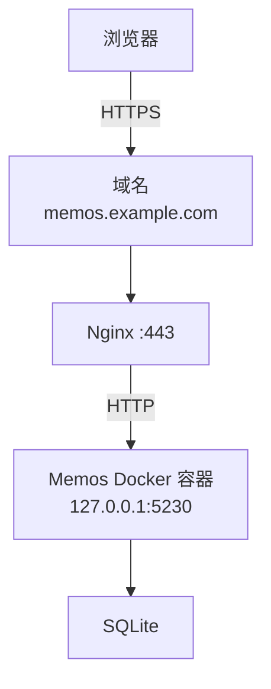

# 背景说明

Memos 是一款开源的自托管笔记工具，界面简洁，支持 Markdown，适合随手记想法、技术笔记和代码片段，也能当临时备忘录。部署在自己的服务器上，笔记数据也由自己保管。

:::note[我的应用场景]

我想用 Memos 给博客加一个随时能更新的「动态」功能。内容在 Memos 里编写、发布和管理，再由博客展示。
:::

::github{repo="usememos/memos"}

---

# Memos 部署

## 部署环境

| 项目 | 说明 |
| --- | --- |
| 操作系统 | Ubuntu 22.04 LTS |
| 容器管理 | Docker + Docker Compose |
| Memos 镜像 | neosmemo/memos |
| 数据库 | SQLite |
| 服务端口 | 5230 |
| 反向代理 | Nginx |
| HTTPS | SSL 证书 |

访问流程如下：



> `memos.example.com` 是示例域名，使用时换成自己的域名。

## Docker 部署

::link-card{title="Memos Docker Compose 官方部署文档" url="https://usememos.com/docs/deploy/docker-compose" image="https://image.xhwen.cn/blog/memos.webp" badge="Memos"}

先创建部署目录：

```bash showLineNumbers=false
sudo mkdir -p /opt/memos/data
cd /opt/memos
```

> `data/` 用来保存数据库和上传的附件。

新建 Docker Compose 配置文件：

```bash showLineNumbers=false
sudo vim docker-compose.yml
```

写入以下配置：

```yaml
<!-- /opt/memos/docker-compose.yml -->
services:
  memos:
    image: neosmemo/memos:stable
    container_name: memos
    restart: unless-stopped

    ports:
      - "127.0.0.1:5230:5230"

    # 持久化数据库及附件
    volumes:
      - ./data:/var/opt/memos

    environment:
      # Memos 服务监听端口
      MEMOS_PORT: "5230"
      # 使用 SQLite 数据库
      MEMOS_DRIVER: sqlite
      # 实例的外部访问地址
      MEMOS_INSTANCE_URL: https://memos.example.com
```

## 启动 Memos

在配置文件所在目录执行：

```bash showLineNumbers=false
docker compose up -d
```

查看运行状态：

```bash showLineNumbers=false
docker compose ps
```

查看容器日志：

```bash showLineNumbers=false
docker compose logs -f memos
```

容器启动后，检查本地服务是否能访问：

```bash showLineNumbers=false
curl -I http://127.0.0.1:5230
```

确认有正常的 HTTP 响应后，继续初始化管理员账户。

## 初始化管理员账户

服务只绑定了服务器的 `127.0.0.1`。先在本地电脑执行下面的命令，通过 SSH 转发端口：

```bash showLineNumbers=false
ssh -L 5230:127.0.0.1:5230 用户名@服务器IP
```

在本地浏览器访问：

```text showLineNumbers=false
http://127.0.0.1:5230
```

按页面提示创建账户。第一个账户就是实例管理员。


> 先创建好管理员账户，再开放域名访问，避免被他人抢先注册。

如果只是自己用，创建账户后记得关闭开放注册。


---

# 配置 Nginx

创建 Nginx 配置：

```bash showLineNumbers=false
sudo vim /etc/nginx/sites-available/memos
```

写入配置：

```nginx
<!-- /etc/nginx/sites-available/memos -->
server {
    listen 80;
    server_name memos.example.com;

    return 301 https://$host$request_uri;
}

server {
    listen 443 ssl;
    server_name memos.example.com;

    # 域名证书
    ssl_certificate     /etc/nginx/ssl/memos.example.com/fullchain.pem;
    ssl_certificate_key /etc/nginx/ssl/memos.example.com/privkey.pem;

    client_max_body_size 50M;

    location / {
        proxy_pass http://127.0.0.1:5230;

        proxy_http_version 1.1;

        proxy_set_header Host $host;
        proxy_set_header X-Real-IP $remote_addr;
        proxy_set_header X-Forwarded-For $proxy_add_x_forwarded_for;
        proxy_set_header X-Forwarded-Proto $scheme;

        proxy_read_timeout 300s;
    }
}
```

:::tip[证书申请]
还没有证书的话，可以参考这篇文章：
> 
> ::link-card{title="Let’s Encrypt 申请 SSL 证书并自动续期" url="/posts/blog/lets-encrypt-wildcard-nginx-auto-renew/" desc="记录如何为 DNS 托管在阿里云或 Cloudflare 的域名申请 Let’s Encrypt 通配符证书，并通过 acme.sh 自动续期。" badge="Blog" target="_self"}
:::

启用站点配置：

```bash showLineNumbers=false
sudo ln -s /etc/nginx/sites-available/memos \
           /etc/nginx/sites-enabled/memos
```

检查配置并重新加载 Nginx：

```bash showLineNumbers=false
sudo nginx -t
sudo nginx -s reload
```

配置完成后，在浏览器中打开 `https://memos.example.com`，确认 Memos 页面能正常访问。


---

# 日常维护

## 数据备份与恢复

::link-card{title="Memos 官方数据备份与恢复" url="https://usememos.com/docs/operations/backup-restore" image="https://image.xhwen.cn/blog/memos.webp" badge="Memos"}

**数据备份**

创建备份目录：

```bash showLineNumbers=false
sudo mkdir -p /opt/memos/backups
```

先停止 Memos，再打包数据目录和配置文件，避免备份时 SQLite 仍在写入：

```bash showLineNumbers=false
cd /opt/memos

docker compose stop memos

sudo tar -czf backups/memos-$(date +%Y%m%d-%H%M%S).tar.gz data docker-compose.yml

docker compose start memos
```

备份包保存在 `/opt/memos/backups/`，包含 SQLite 数据库、本地上传的附件和 Docker Compose 配置文件。

**恢复数据**

假设备份文件为：`memos-20261013-120000.tar.gz`

先停止服务：

```bash showLineNumbers=false
cd /opt/memos

docker compose down
```

确认备份文件无误后，先把现有的 `data` 目录移到别处保存，避免旧文件残留。然后解压备份：

```bash showLineNumbers=false
sudo tar -xzf backups/memos-20261013-120000.tar.gz -C /opt/memos
```

重新启动：

```bash showLineNumbers=false
docker compose up -d
```

恢复完成后，检查管理员登录、历史笔记和附件是否正常。

## 更新服务

**更新前一定要先备份数据。**

::link-card{title="Memos 官方升级指南" url="https://usememos.com/docs/operations/upgrade" image="https://image.xhwen.cn/blog/memos.webp" badge="Memos"}

这里使用的是 `stable` 标签，拉取新镜像后重新创建容器即可更新：

```bash showLineNumbers=false
cd /opt/memos

docker compose pull

docker compose up -d
```

> 跨版本较大时，先看官方升级说明，确认是否需要先升级到某个中间版本。
