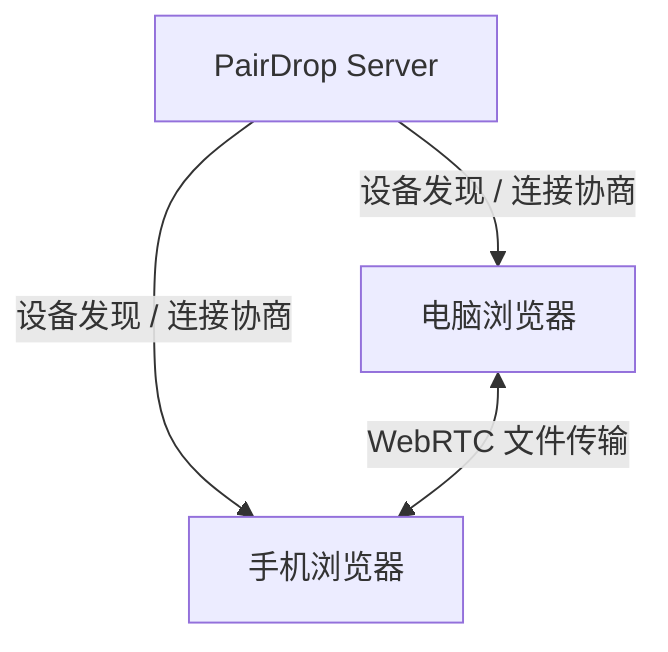
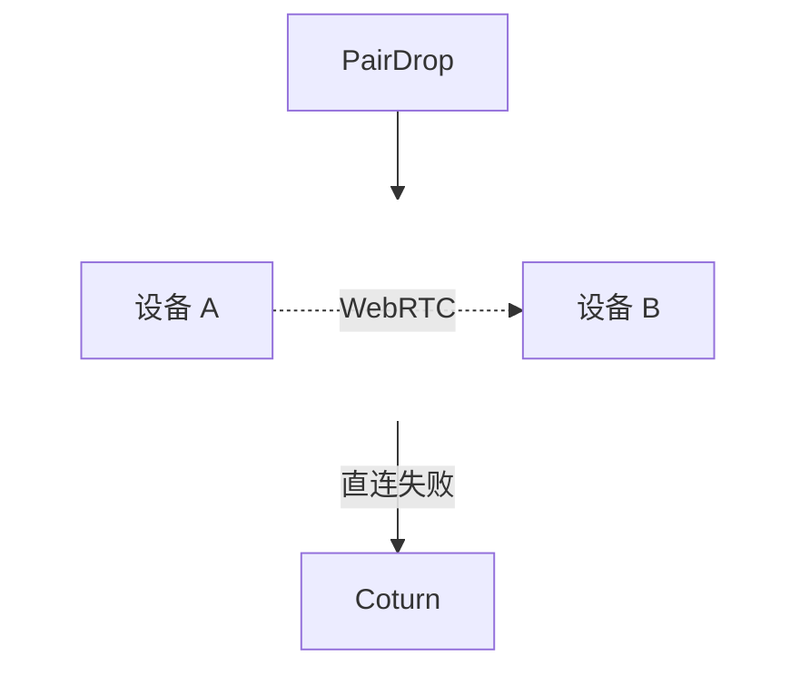

# 背景说明

平时在电脑、手机和平板之间传文件，经常用微信、QQ、网盘或数据线。设备一多，来回切换就有些麻烦。

PairDrop 是一个基于浏览器的跨平台文件传输工具，不用注册账号，打开网页就能发现其他设备并发送文件。两端需要访问同一个 PairDrop 实例：通常在同一网络下会自动发现，跨网络则需要配对或加入同一个临时房间。

::github{repo="schlagmichdoch/PairDrop"}

PairDrop 的前端主要运行在浏览器中，文件优先通过 WebRTC 在设备之间传输。



---

# PairDrop 安装

## Docker 部署

创建 PairDrop 的部署目录：

```bash showLineNumbers=false
sudo mkdir -p /opt/pairdrop
cd /opt/pairdrop
```

新建 Docker Compose 配置文件：

```bash showLineNumbers=false
sudo vim docker-compose.yml
```

写入：

```yaml
<!-- /opt/pairdrop/docker-compose.yml -->
services:
  pairdrop:
    image: lscr.io/linuxserver/pairdrop:latest
    container_name: pairdrop
    restart: unless-stopped
    environment:
      - PUID=1000
      - PGID=1000
      - TZ=Asia/Shanghai
      # 浏览器不支持或禁用 WebRTC 时，是否允许通过 WebSocket 中转文件
      - WS_FALLBACK=false
      # 请求频率限制
      - RATE_LIMIT=false
      # 自定义 STUN / TURN 配置
      - RTC_CONFIG=false
      # 调试模式
      - DEBUG_MODE=false
    ports:
      - "127.0.0.1:3000:3000"
```

:::note[传输方式]
PairDrop 默认尝试建立 WebRTC 连接。如果浏览器不支持或禁用了 WebRTC，可以开启 WebSocket 备用传输：

```yaml showLineNumbers=false
WS_FALLBACK=true
```

> 启用 WebSocket 备用传输后，文件会经过 PairDrop 服务端，占用服务器带宽，服务端也能读取传输内容。请只在可信实例上使用。
:::

## 启动 PairDrop

检查配置：

```bash showLineNumbers=false
docker compose config
```

启动：

```bash showLineNumbers=false
docker compose up -d
```

查看容器：

```bash showLineNumbers=false
docker compose ps
```

查看日志：

```bash showLineNumbers=false
docker compose logs -f
```

---

# 配置 Nginx

下面以 `drop.example.com` 为例。

创建 Nginx 配置：

```bash showLineNumbers=false
sudo vim /etc/nginx/sites-available/pairdrop
```

```nginx
<!-- /etc/nginx/sites-available/pairdrop -->
server {
    listen 80;
    server_name drop.example.com;
    return 301 https://$host$request_uri;
}

server {
    listen 443 ssl;
    server_name drop.example.com;

    # 域名证书
    ssl_certificate     /etc/nginx/ssl/drop.example.com/fullchain.pem;
    ssl_certificate_key /etc/nginx/ssl/drop.example.com/privkey.pem;

    location / {
        proxy_pass http://127.0.0.1:3000;
        proxy_http_version 1.1;
        proxy_set_header Host $host;
        proxy_set_header Upgrade $http_upgrade;
        proxy_set_header Connection "upgrade";
        proxy_set_header X-Forwarded-For $remote_addr;
        proxy_set_header X-Forwarded-Proto $scheme;
        proxy_read_timeout 300s;
    }
}
```

:::note[反向代理]
反向代理需要把客户端 IP 传给 PairDrop：

```nginx showLineNumbers=false
proxy_set_header X-Forwarded-For $remote_addr;
```

PairDrop 根据客户端 IP 判断设备之间的网络关系。如果收到的都是 Docker 或 Nginx 的地址，设备发现就可能出问题。
> 
> ::link-card{title="PairDrop 反向代理说明" url="https://github.com/schlagmichdoch/PairDrop/blob/master/docs/host-your-own.md#http-server" image="https://image.xhwen.cn/banner/pairdrop-logo.webp" badge="PairDrop"}
:::

启用：

```bash showLineNumbers=false
sudo ln -s /etc/nginx/sites-available/pairdrop \
           /etc/nginx/sites-enabled/pairdrop
```

检查配置并重新加载 Nginx：

```bash showLineNumbers=false
sudo nginx -t
sudo nginx -s reload
```

现在可以访问 `http://drop.example.com`：


---

# 自建 Coturn（可选）

配对或加入同一个临时房间后，两端能找到对方。传文件还需要建立 WebRTC 连接。

PairDrop 默认的 WebRTC 配置只有 STUN 服务，用来辅助直连，没有 TURN 中继。

两端能直连的话，可以跳过本节。如果浏览器支持 WebRTC，却因为 NAT 或防火墙等原因无法直连，可以配置 TURN，让文件通过中继服务器传输。

下面把 coturn 和 PairDrop 部署在同一台 Linux 云服务器上。网页继续走 `drop.example.com:443`，TURN 使用 `turn.example.com:3478/5349`。

::link-card{title="PairDrop 官方 coturn 示例" url="https://github.com/schlagmichdoch/PairDrop/blob/master/docs/host-your-own.md#coturn-and-pairdrop-via-docker-compose" image="https://image.xhwen.cn/banner/pairdrop-logo.webp" badge="PairDrop"}



## 放行端口并准备证书

在云服务器安全组和系统防火墙中放行下面的端口，范围要和 coturn 配置一致：

| 端口 | 协议 | 用途 |
| --- | --- | --- |
| 3478 | UDP | STUN、TURN/UDP |
| 5349 | TCP | TURN over TLS |
| 49160-49200 | UDP | TURN 中继端口 |

`49160-49200` 是 coturn 官方 Docker 文档中的一个较小示例范围。个人使用可以先用这个范围验证，同时使用的人多时再按需扩大。[coturn Docker 文档](https://github.com/coturn/coturn/blob/master/docker/coturn/README.md#why-so-many-ports-opened)

为 `turn.example.com` 准备有效证书，把证书链和私钥放进 `/opt/pairdrop/ssl`。coturn 容器的运行用户需要能读取这两个文件。

:::note[域名证书配置]
> 
> ::link-card{title="Let’s Encrypt 申请 SSL 证书并自动续期" url="/posts/blog/lets-encrypt-wildcard-nginx-auto-renew/" desc="记录如何为 DNS 托管在阿里云或 Cloudflare 的域名申请 Let’s Encrypt 通配符证书，并通过 acme.sh 自动续期。" badge="Blog" target="_self"}
:::

下面以镜像默认的 `nobody:nogroup`（UID/GID 65534）为例，源路径请换成自己的证书路径：

```bash showLineNumbers=false
sudo install -d -m 750 -o root -g 65534 /opt/pairdrop/ssl
sudo cp -i /path/to/turn-certs/fullchain.pem /opt/pairdrop/ssl/fullchain.pem
sudo cp -i /path/to/turn-certs/privkey.pem /opt/pairdrop/ssl/privkey.pem
sudo chown root:65534 /opt/pairdrop/ssl/fullchain.pem /opt/pairdrop/ssl/privkey.pem
sudo chmod 640 /opt/pairdrop/ssl/fullchain.pem /opt/pairdrop/ssl/privkey.pem
```

## 配置 Coturn 和 WebRTC

在 `/opt/pairdrop` 创建 `turnserver.conf`：

```bash showLineNumbers=false
sudo vim /opt/pairdrop/turnserver.conf
```

```text 
<!-- /opt/pairdrop/turnserver.conf -->
# external-ip=<公网IP>/<服务器私网IP>
realm=turn.example.com
server-name=turn.example.com
listening-port=3478
tls-listening-port=5349
min-port=49160
max-port=49200
fingerprint
lt-cred-mech
user=<TURN_USER>:<TURN_PASSWORD>
cert=/opt/pairdrop/ssl/fullchain.pem
pkey=/opt/pairdrop/ssl/privkey.pem
log-file=stdout
no-cli
no-multicast-peers
```

> 如果公网地址通过 NAT 映射到服务器私网地址，需要补充类似：`external-ip=<公网IP>/<服务器私网IP>`
> 
> `<TURN_USER>` 与 `<TURN_PASSWORD>` 换成自己生成的随机凭据。

官方 coturn 镜像默认以非 root 用户运行。配置文件包含 TURN 凭据，需要让该用户能读取，同时限制其他本机用户访问。文件由 root 创建时，可以这样设置权限：

```bash showLineNumbers=false
sudo chown root:65534 /opt/pairdrop/turnserver.conf
sudo chmod 640 /opt/pairdrop/turnserver.conf
```

再创建 `rtc_config.json`：

```bash showLineNumbers=false
sudo vim /opt/pairdrop/rtc_config.json
```

```json
<!-- /opt/pairdrop/rtc_config.json -->
{
  "sdpSemantics": "unified-plan",
  "iceServers": [
    {
      "urls": "stun:turn.example.com:3478"
    },
    {
      "urls": [
        "turn:turn.example.com:3478?transport=udp",
        "turns:turn.example.com:5349?transport=tcp"
      ],
      "username": "<TURN_USER>",
      "credential": "<TURN_PASSWORD>"
    }
  ]
}
```

> `<TURN_USER>` 与 `<TURN_PASSWORD>` 必须与 `turnserver.conf` 中的配置相同。

TURN 凭据会随 WebRTC 配置发给浏览器。访问这个 PairDrop 实例的人都能拿到这些凭据，也能用在其他支持 TURN 的客户端中。

如果把实例开放给其他人使用，要留意 TURN 的带宽和流量消耗，发现凭据泄露或被滥用时及时更换。

## 更新 Compose 并启动 Coturn

把 `/opt/pairdrop/docker-compose.yml` 改为下面的配置。

coturn 使用 Linux 主机网络，可以直接使用配置中的中继端口。官方 Docker 镜像文档也推荐这种方式，可以避免映射大段端口的开销。

```yaml
<!-- /opt/pairdrop/docker-compose.yml -->
services:
  pairdrop:
    image: lscr.io/linuxserver/pairdrop:latest
    container_name: pairdrop
    restart: unless-stopped
    environment:
      - PUID=1000
      - PGID=1000
      - TZ=Asia/Shanghai
      - WS_FALLBACK=false
      - RATE_LIMIT=false
      # 自定义 STUN/TURN 配置在容器内的路径
      - RTC_CONFIG=/home/node/app/rtc_config.json
      - DEBUG_MODE=false
    volumes:
      # 只读挂载，冒号右侧路径必须和 RTC_CONFIG 一致
      - ./rtc_config.json:/home/node/app/rtc_config.json:ro
    ports:
      - "127.0.0.1:3000:3000"

  coturn:
    image: coturn/coturn:4
    container_name: pairdrop-coturn
    restart: unless-stopped
    # 使用宿主机网络，3478、5349 和中继端口不用再逐个映射
    network_mode: host
    # 启动时加载容器内的这份配置
    command: ["-c", "/opt/pairdrop/turnserver.conf"]
    volumes:
      # 配置文件只读挂载到 command 指定的路径
      - ./turnserver.conf:/opt/pairdrop/turnserver.conf:ro
      # 证书目录。turnserver.conf 的 cert、pkey 要写容器内路径
      - ./ssl:/opt/pairdrop/ssl:ro
```

检查配置：

```bash showLineNumbers=false
docker compose config
```

启动：

```bash showLineNumbers=false
docker compose up -d
```

查看容器：

```bash showLineNumbers=false
docker compose ps
```

查看日志：

```bash showLineNumbers=false
docker compose logs -f
```

:::warning[注意]
`rtc_config.json` 是给浏览器使用的配置，PairDrop 容器必须能读取它。如果创建文件时限制了权限，先检查挂载路径和文件权限，再看 PairDrop 日志。

coturn 的证书权限也要通过日志核对，不能只看容器是否处于运行状态。
:::

## 网络验证

让电脑和手机分别连接不同的网络，两端都访问 `https://drop.example.com`。通过配对码或同一个临时房间找到对方，然后发送文件，观察传输是否稳定。

文件传完后，再检查浏览器的 WebRTC 连接信息，确认是否用了 TURN 中继。

例如在浏览器打开 `chrome://webrtc-internals`，查看本次选中的 ICE candidate pair，若候选类型为 `relay`，才说明走了 TURN 中继。


如果两端能直连，就可能完全用不到 coturn。
